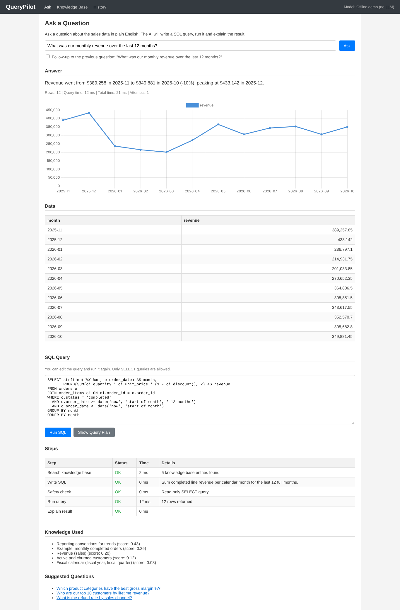
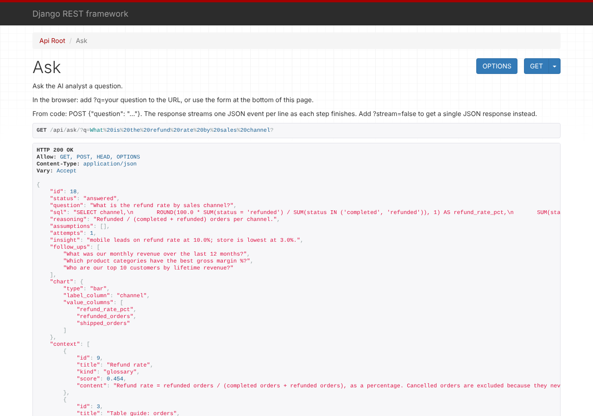
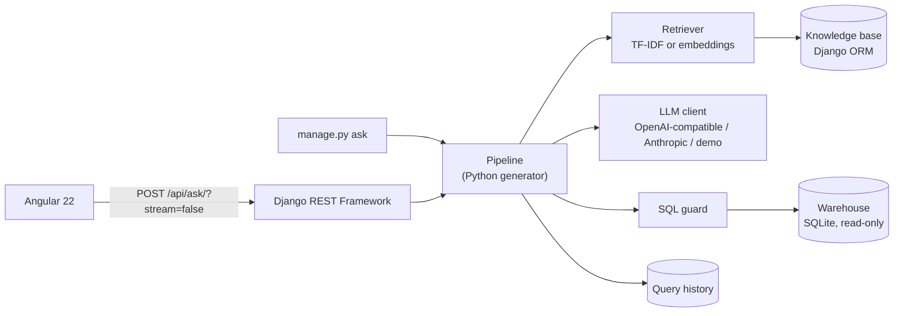

# QueryPilot: an AI data analyst

Ask a business question in plain English ("Which product categories have the best gross margin?") and QueryPilot answers with a short insight, a chart, the data table and the exact SQL it ran.

It is a small but complete **RAG + LLM pipeline** with a **Django REST** backend and an **Angular** frontend:

1. **Retrieve**: searches a company knowledge base (business rules, table guides, example queries) for the entries relevant to the question.
2. **Write SQL**: an LLM writes one SQLite query using the schema plus that retrieved context.
3. **Safety check**: the query must be a single read-only `SELECT`; the database connection itself is read-only too.
4. **Run**: executes against a demo retail database (1,200 customers, about 9,400 orders over 2 years).
5. **Self-correct**: if the query fails, the database error goes back to the LLM and it fixes its own SQL (up to 3 tries).
6. **Explain**: the LLM writes a short insight and suggests follow-up questions; the chart type is picked by plain code.



---

## Run it on your laptop

You need **Python 3.10+** and **Node.js 22.22+ or 24.15+** (Angular 22 requires one of these). Check with `python --version` and `node --version`.

### 1. Backend (Django), in terminal 1

**Windows (PowerShell)**
```powershell
cd backend
python -m venv .venv
.venv\Scripts\Activate.ps1
pip install -r requirements.txt
copy .env.example .env
python manage.py migrate
python manage.py seed_demo
python manage.py runserver
```

**macOS / Linux**
```bash
cd backend
python3 -m venv .venv
source .venv/bin/activate
pip install -r requirements.txt
cp .env.example .env
python manage.py migrate
python manage.py seed_demo
python manage.py runserver
```

If PowerShell refuses to run `Activate.ps1`, run `Set-ExecutionPolicy -Scope CurrentUser RemoteSigned` once, then try again.

### 2. Frontend (Angular), in terminal 2

```bash
cd frontend
npm install
npm start
```

Open **http://localhost:4200**. The navbar shows which LLM is connected.

### 3. Connect a real LLM

Out of the box it runs in **offline demo mode**: no key needed, but it can only answer the six sample questions. For the interview, connect a real model by editing `backend/.env` (all options are written out in `.env.example`), then restart the backend.

| Option | Cost | Needs internet | Setting |
|---|---|---|---|
| Google Gemini | Free tier | Yes | `LLM_PROVIDER=openai` + Gemini base URL |
| Ollama (local) | Free | No | `LLM_PROVIDER=openai` + `http://localhost:11434/v1` |
| OpenAI | Paid | Yes | `LLM_PROVIDER=openai` |
| Anthropic Claude | Paid | Yes | `LLM_PROVIDER=anthropic` |

Tip: set up a real provider **and** keep the demo mode as a backup. If the Wi-Fi fails, change `LLM_PROVIDER=demo` and restart.

---

## Using the backend without the frontend

Start only the backend (`python manage.py runserver`). There are four ways to see it working.

### A. In the browser: the API pages

Open **http://127.0.0.1:8000/**. Django REST Framework shows every endpoint as a clickable web page.

| Open this | What you see |
|---|---|
| http://127.0.0.1:8000/api/ | Links to everything below |
| http://127.0.0.1:8000/api/ask/?q=What is the refund rate by sales channel? | The full answer: SQL, rows, insight, chart type and every step. Change the text after `?q=` to ask anything. |
| http://127.0.0.1:8000/api/ask/ | A form at the bottom of the page where you can type a question and click **POST** |
| http://127.0.0.1:8000/api/tables/customers/ | The first 20 rows of a table (also `products`, `orders`, `order_items`; add `?limit=50` for more) |
| http://127.0.0.1:8000/api/schema/ | All tables, columns and row counts |
| http://127.0.0.1:8000/api/knowledge/ | The knowledge base, with a form to add entries |
| http://127.0.0.1:8000/api/history/ | The last 30 questions asked |
| http://127.0.0.1:8000/api/sql/run/ | A form to run your own `SELECT` query (try `DELETE FROM customers` to see it blocked) |



### B. In the terminal: ask a question

```bash
python manage.py ask What is the refund rate by sales channel?
```

It prints each step (knowledge found with scores, the SQL, the safety check), the result as a text table, the AI's insight and suggested next questions:

```
Question: What is the refund rate by sales channel?
[ok]     Search knowledge base (4 ms)
           - Refund rate  (score 0.45)
           - Table guide: orders  (score 0.20)
[ok]     Write SQL (0 ms)
           SELECT channel, ROUND(100.0 * SUM(status = 'refunded') / ...
[ok]     Safety check (0 ms)
[ok]     Run query (3 ms)
[ok]     Explain result (0 ms)

Answer
mobile leads on refund rate at 10.0%; store is lowest at 3.0%.
+---------+-----------------+-----------------+----------------+
| channel | refund_rate_pct | refunded_orders | shipped_orders |
+---------+-----------------+-----------------+----------------+
| mobile  |           10.00 |             270 |          2,692 |
...
```

Use `--rows 5` to print fewer rows.

### C. Django admin: browse the stored data

```bash
python manage.py createsuperuser
```

Pick any username and password, then open **http://127.0.0.1:8000/admin/** and log in. You can search and edit the knowledge base, and see every question asked (status, SQL, attempts, time).

### D. With curl: see the live stream

The `/api/ask/` endpoint streams one JSON line per step as it finishes. From macOS/Linux or Git Bash:

```bash
curl -N -X POST http://127.0.0.1:8000/api/ask/ \
  -H "Content-Type: application/json" \
  -d '{"question": "Which product categories have the best gross margin %?"}'
```

Add `?stream=false` to the URL to get one JSON response instead (this is what the Angular app uses).

---

## 5-minute interview demo script

1. **Ask a sample question** ("What was our monthly revenue over the last 12 months?"). Point at the **Steps** table: *"It searched the knowledge base, wrote SQL, passed the safety check, ran the query and explained it. Knowledge Used shows which business rules it retrieved, with similarity scores."*
2. **Scroll to SQL Query and click Show Query Plan.** *"Nothing is a black box. SQLite's plan shows it uses the `order_date` index instead of scanning the table."*
3. **Show the RAG moment (the best part):**
   - Ask *"How many VIP customers do we have in each region?"* A real LLM usually guesses a threshold and shows it under "Note: the AI assumed"; demo mode says VIP isn't defined.
   - Go to **Knowledge Base**, click **Fill VIP Example** ($10,000 lifetime revenue), then **Save**.
   - Ask the same question again. VIP is now at the top of Knowledge Used and the SQL uses `>= 10000`. *"I changed the AI's behavior without touching code or retraining. That's what RAG is for."*
4. **Ask a fiscal-calendar question** ("What was revenue by fiscal quarter in FY2025?"). *"Our fiscal year starts Feb 1. No model could know that; it comes from the knowledge base."*
5. **Show the safety layers.** In the SQL box type `DELETE FROM customers` and click **Run SQL**. *"Blocked by the guard. Even if the guard had a bug, the connection is read-only with an authorizer that denies writes. There's a test that proves it."*
6. **Ask a follow-up**: tick **Follow-up to the previous question** and ask "now break that down by region". *"It sends the previous question and SQL as context."*
7. **Show the backend on its own**: open http://127.0.0.1:8000/api/ or run `python manage.py ask ...` in a terminal.
8. **Run the tests**: `cd backend && pytest` → 82 passing in about 2 seconds.

---

## Architecture



### Project layout

```
backend/
  analyst/
    services/
      pipeline.py      the orchestrator; yields one event per step
      retriever.py     RAG: TF-IDF vectors + cosine similarity (or API embeddings)
      llm.py           provider clients with retry + exponential backoff
      prompts.py       prompt templates + tolerant JSON parsing of model replies
      sql_guard.py     single SELECT statement only
      warehouse.py     read-only connection, authorizer, timeout, row cap, EXPLAIN
      charting.py      picks line / bar / KPI from the result shape
      demo_llm.py      offline provider for demos without internet
    management/commands/
      seed_demo.py     builds the demo database and knowledge base
      ask.py           ask a question from the terminal
    views.py, serializers.py, urls.py, models.py, admin.py
    demo_data.py       generates the retail data
    knowledge_seed.py  starter business rules
    tests/             82 pytest tests
frontend/src/app/
  services/api.ts      all HTTP calls to Django
  models.ts            TypeScript types for the API responses
  pages/ask/           question box, answer, chart, data, SQL, steps
  pages/knowledge/     knowledge base form and table
  pages/history/       past questions
  components/result-chart/   Chart.js chart
```

### API

| Method | Path | Purpose |
|---|---|---|
| GET | `/api/` | Links to every endpoint |
| GET | `/api/health/` | LLM provider, data range, sample questions |
| GET | `/api/ask/?q=...` | Ask a question; one JSON response |
| POST | `/api/ask/` | Ask a question; streams newline-delimited JSON (add `?stream=false` for one response) |
| POST | `/api/sql/run/` | Run hand-written SQL (same guard as the AI) |
| POST | `/api/sql/explain/` | SQLite query plan |
| GET | `/api/tables/<name>/` | First rows of a table |
| GET | `/api/schema/` | Tables, columns, row counts |
| GET/POST/PUT/DELETE | `/api/knowledge/` | Knowledge base CRUD (DRF ViewSet) |
| GET | `/api/history/` | Last 30 questions |

---

## Talking points (questions you're likely to get)

**Why does the API stream the steps?** An LLM call takes 1 to 5 seconds, so a client can show progress as each step finishes. The pipeline is a Python generator wrapped in Django's `StreamingHttpResponse`. The Angular app keeps it simple and asks for one JSON response (`?stream=false`); the same generator feeds both modes and the terminal command.

**Why RAG and not just put everything in the prompt?** The schema is small, so it always goes in. Business knowledge grows without limit (definitions, fiscal rules, edge cases), so only the relevant entries are retrieved per question. It also means business users can change the AI's behavior by editing a definition, with no deploy.

**Why TF-IDF instead of neural embeddings?** It runs offline with zero setup and is plenty for about 20 documents. The retriever has one interface with two backends; switch to neural embeddings (OpenAI, or Ollama's `nomic-embed-text`) with one `.env` line. Trade-off: TF-IDF misses synonyms, which is why the knowledge entries list them ("revenue, also called sales").

**How do you stop the AI from damaging data?** Five layers: (1) a parser-based guard allows only one `SELECT`; (2) the database is opened in SQLite read-only mode; (3) an authorizer callback denies every operation except reads; (4) a progress handler stops queries over 5 seconds; (5) results are capped at 500 rows. `test_warehouse.py` runs `DELETE`/`UPDATE`/`CREATE` directly, bypassing the guard, to prove layers 2 and 3 hold. In production I'd also use a database user with only `SELECT` grants.

**How does self-correction work?** If execution fails, the model's reply and the exact database error are added to the conversation, and the model tries again, up to `MAX_SQL_ATTEMPTS`. A query blocked by the guard is *not* retried: that's a policy decision, not a bug to fix.

**What if the model returns bad JSON?** `prompts.parse_sql_reply` strips markdown fences, finds the JSON object, and falls back to extracting a ```` ```sql ```` block. If that fails it asks the model to reformat. Tested in `test_pipeline.py`.

**Why does code pick the chart, not the LLM?** It's deterministic, instant and free. Use the LLM only for what needs language understanding.

**Is it a real database?** It's SQLite, a real SQL engine, with generated data so it runs anywhere with no setup. All database access goes through `warehouse.py`, so moving to PostgreSQL or Snowflake means changing that module and the SQL dialect in the prompt, not the rest of the app.

**How would you take this to production?** PostgreSQL/Snowflake/BigQuery behind the same `warehouse` interface with a read-only role; pgvector for the knowledge base; authentication and per-user row-level security; an evaluation set of question/SQL pairs to catch prompt regressions; caching of identical questions; rate limiting.

---

## Tests

```bash
cd backend
pytest
```

Covers the SQL guard (allowed and blocked statements), the read-only database layer, timeouts and row caps, retrieval ranking, provider embedding caching, chart selection, the full pipeline including self-correction and fallbacks (with a scripted fake LLM), the streaming and single-response API, the browsable API pages, the admin, the `ask` command, the RAG end-to-end flow, and the HTTP client's retry/backoff.

## Troubleshooting

- **"Backend not running" in the navbar**: the Django server isn't running on port 8000.
- **"Could not connect to the backend"** on the Ask page: same as above.
- **"no such table: django_session" or similar**: run `python manage.py migrate` again.
- **"The demo warehouse is missing"**: run `python manage.py seed_demo`.
- **HTTP 404 from the model**: the model name in `LLM_MODEL` was retired; check the provider's current model list.
- **Reset the knowledge base to the starter set**: `python manage.py seed_demo --reset-knowledge`.
